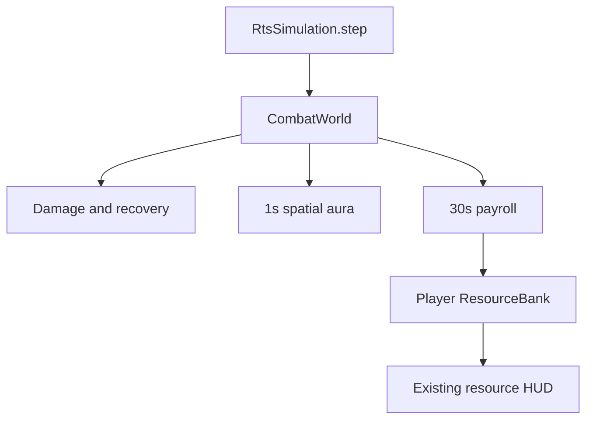

# Stage 2 — Combat Matrix & Asymmetrical Mechanics

> Stage 3 bổ sung cao độ: +25% sau armor/counter, `bind_terrain` và explicit
> elevation. Xem [Stage 3 guide](STAGE_3_MAPS_MISSIONS.md). Ví dụ damage ở tài liệu
> Stage 2 này mặc định hai đơn vị cùng độ cao; luật aura/payroll giữ nguyên.

Engine: **Godot 4.5.2 Standard**, typed GDScript. Đây là backend chạy được bằng
Godot thật, nối với clock và ResourceBank của Stage 1. F5/F6/F7 vẫn là scene thử
economy/navigation; Stage 2 chưa thêm giao diện điều khiển quân chiến đấu.

> Stage 4 thêm wind-up tùy chọn và `attack_started`/`attack_cancelled`; xem
> [Stage 4 guide](STAGE_4_ASSETS_AUDIO.md). Marker mặc định 0 giữ fixture này.

> Stage 5 chuyển catalog sang JSON/schema, giữ các base stats và override dưới
> đây. Xem [Stage 5 guide](STAGE_5_BALANCE.md) cho reload, cost metadata và arena.

## 1. Luật Stage 2 và quan hệ với GDD

Yêu cầu triển khai Stage 2 mới nhất là nguồn quyết định cho các hàng dưới.
Các bản GDD trong `docs/gdd/` được giữ nguyên để theo dõi lịch sử thiết kế.
Đây là một ruleset prototype, chưa phải cân bằng ranked cuối cùng.

| Cơ chế | GDD trước đó | Backend Stage 2 |
|---|---|---|
| Pikeman chống Cavalry | +22 ở tier A3 | **+25 additive damage**, theo ví dụ Stage 2 |
| Preacher aura | Radius 4, thêm base damage, giới hạn melee infantry cùng chủ | **Radius 6**, mọi quân cùng team đang ở trên bản đồ, kể cả nguồn và đồng minh khác chủ |
| Aura stats | +1/+2 attack, UT A4 thêm speed | **Attack rate ×1.15 và movement speed ×1.15**; không tăng attack damage |
| Aura membership | Mất ngay khi rời vùng | Quét **mỗi 1 giây mô phỏng**; vào/ra vùng có độ trễ tối đa 1 giây |
| Payroll | Campaign contracts, 5G/120s theo unit-seconds, thời gian nợ | **Mỗi 30s**, đếm Landsknecht còn thuộc chủ ở thời điểm chốt; mặc định **1G/quân/kỳ**, chỉnh được |
| Gold hết | Nợ → refusal → desertion theo deadline | Gold sau thanh toán bằng 0 → **nổi loạn ngay tại kỳ lương**, kể cả vừa đủ trả |
| Phạm vi payroll | Campaign opt-in | **Scenario opt-in**, chỉ chủ Swabian League; không tự bật trong F6/F7 |

Aura này không phải hai thanh Zeal/Fear hoặc Frenzy của campaign. Backend không
áp dụng đồng thời aura damage cũ. Payroll này không giả vờ triển khai công ty,
hóa đơn nợ hoặc unit-seconds của GDD Phase 3.

## 2. Source và quyền sở hữu dữ liệu

| File / class | Trách nhiệm |
|---|---|
| `scripts/combat/combat_world.gd` / CombatWorld | Registry, ownership, lệnh tấn công, fixed clock, batch damage, events |
| `combat_types.gd` / CombatTypes | Faction, UnitType, ArmorClass, damage channel |
| `unit_catalog.gd` / CombatUnitCatalog | Chỉ số base, độc lập cho từng đơn vị |
| `combat_unit.gd` / CombatUnit | HP, vị trí thực, recovery, getter chỉ số hiệu lực |
| `damage_calculator.gd` / DamageCalculator | Hàm tính damage thuần, không UI hoặc thay đổi HP |
| `stat_modifiers.gd` / CombatStatModifiers | Effect theo khóa; cache attack/movement multiplier |
| `combat_spatial_hash.gd` / CombatSpatialHash | Bucket 6 ô; truy vấn vòng tròn bằng bình phương khoảng cách |
| `zeal_aura.gd` / ZealAura | Hợp nhất người nhận, thêm/xóa đúng một effect Zeal |
| `combat_player.gd` / CombatPlayer | Team, faction, cùng instance ResourceBank, cấu hình lương/deadline |
| `mercenary_maintenance.gd` / MercenaryMaintenance | Đếm quân theo chủ, trừ Gold, trả invoice và danh sách đào ngũ |
| `examples/stage2_backend_demo.gd` | Ví dụ chạy 90 game seconds, in aura/damage/payroll/desertion |
| `tests/combat_tests.gd` | Regression cases và stress fixture 200 đơn vị |



Model dùng RefCounted; không dùng Node, SceneTree lookup, `_process()` hay Timer
cho từng quân. Services không giữ tham chiếu ngược về CombatWorld. Combat IDs có
namespace riêng với ID dân/tài nguyên của Stage 1; host giữ mapping khi làm adapter.

## 3. Damage & counter matrix

```text
normal = max(1, base_attack - armor_of_matching_channel)
counter = sum(max(0, attacker_bonus[class] - target_bonus_armor[class]))
damage = normal + counter
```

Chỉ cộng counter nếu mục tiêu mang đúng armor class. Class là set để một tag
lặp không nhân đôi damage. M/P armor không trừ vào phần counter. Đơn vị không có
đòn đánh như Preacher luôn có damage 0, không nhận quy tắc minimum damage 1.

| Attacker | Channel | Counter |
|---|---|---|
| Pikeman | Melee | +25 Cavalry |
| Landsknecht | Melee | +24 Cavalry |
| Flailman | Melee | +4 Spear |
| Arquebusier | Pierce | +6 Infantry |
| Skirmisher | Pierce | +3 Archer, +2 Spear; chỉ class thực sự khớp |
| Light Cavalry | Melee | +8 Clergy |
| Villager / Ritter / Crossbowman | M / M / P | Không class bonus |
| Radical Preacher | Không attack | Không gây damage |

Landsknecht mang Infantry + Spear. Arquebusier mang Archer, không mang melee
Infantry. Các stats lấy base từ GDD, trừ Pike +25 đã ghi ở trên. Chưa áp dụng
Blacksmith, Elite, armor bonus A3, heal, conversion, charge hoặc artillery splash.

**Ví dụ:** Pike attack 4 đánh Ritter melee armor 2: `4 - 2 + 25 = 27`.
Nếu giáp thường của Ritter tăng lên 200: `1 + 25 = 26`. Nếu còn có Cavalry bonus
armor 10: `1 + (25 - 10) = 16`. Aura không đổi ba kết quả này.

CombatWorld kiểm tra owner, khác team, sống, deployed, tầm và hồi đòn trước khi
dùng calculator. Tầm melee đo ngoài hai bán kính thân, ranged đo từ tâm; catalog
tạm dùng radius 0.18. Đây không phải hệ thống clearance/collision của cavalry.
Attack order ngoài tầm chờ vị trí do navigation cập nhật; backend không tự chase.

Các đòn hợp lệ cùng tick được chụp trước rồi cộng damage lên HP cùng lượt.
Hai quân gây đòn chí mạng cho nhau đều chết; không có lợi thế do thứ tự ID.
Death giải phóng registry, xóa lệnh/effect và emit một lần. ID không tái sử dụng.
`hit_resolved.damage` là damage tính toán, có thể overkill; `target_hp_after` là HP
sau cả batch. Không dùng damage overkill để tính lifesteal/Salvage.

## 4. Attack speed, movement và aura

`AttackSpeed +15%` được định nghĩa là tăng **tần suất đánh**, do đó:

```text
effective_period = base_period / 1.15
effective_movement = base_movement * 1.15
```

Pike 3 giây/đòn thành khoảng **2.609 giây/đòn**; 1 ô/giây thành **1.15 ô/giây**.
Combat tick 50ms lượng tử hóa thời điểm đòn lên tick kế tiếp. Recovery lưu theo
base work-seconds; đổi buff giữa chu kỳ tác động lên phần còn lại, không reset đòn.
Stop/Attack liên tục cũng không tạo đòn miễn phí. Không tích nhiều đòn khi idle.

Aura quét ở tick 20, 40, 60...:

1. Rebuild spatial hash từ các body còn sống và `on_field=true`.
2. Mỗi Bundschuh Radical Preacher hợp lệ query circle radius 6, kể cả khoảng cách
   đúng bằng 6; filter cùng team. Không kiểm tra LOS hoặc thay đổi vision.
3. Hợp nhất ID người nhận; đặt effect key `radical_preacher_zeal` về `(1.15, 1.15)`.
4. Xóa key đó ở các ID từng được buff nhưng không còn trong hợp.

Mười Preachers không tạo `1.15^10`. Các effect khác có key riêng được nhân khi
tính chỉ số; xóa Zeal giữ nguyên chúng. Không thay đổi base stats tại mỗi refresh.
Source chết/despawn/garrison/ngừng cùng team làm các người nhận cũ mất buff ở lần
scan kế tiếp, tối đa 1 giây. Target đổi chủ hoặc garrison mất buff ngay.

## 5. Payroll và DesertionEvent

Mỗi player bật maintenance có lần trả đầu sau **30 game seconds kể từ đăng ký**,
sau đó giữ nguyên nhịp 30s. Giá mặc định 1G/quân/kỳ là tuning mới; có thể truyền
`wage` khác. Không dùng wall clock, không bill khi pause, không reset lịch khi
recruit/đổi group/thu thêm vàng.

```text
count = living registered Landsknechts owned by this player
due = count * wage
charged = min(current_gold, due)
gold_after = current_gold - charged
if count > 0 and gold_after == 0: all counted soldiers mutiny
```

- Idle, đang đánh và garrison đều tính lương. Chết, bị xóa, đổi chủ, đã mutiny và
  hàng đợi tuyển chưa thành đơn vị đều không nằm trong roster chủ cũ.
- Đây là snapshot tại deadline, không tính phần thời gian phục vụ trong kỳ.
  Quân xuất hiện sát deadline vẫn chịu cả kỳ; quân rời roster trước đó không bị bill.
- Trả một phần là transaction cố ý riêng của payroll. `ResourceBank.try_spend`
  dùng cho xây dựng vẫn giữ nguyên luật all-or-nothing.
- Có 2 lính, wage 1, Gold 5: các kỳ 30/60/90s lần lượt còn 3/1/0; kỳ 90 phát mutiny.
- Có 2 lính và Gold đúng 2: trả đủ về 0 **vẫn mutiny**, đúng yêu cầu Stage 2.
- Không có lính: không phát DesertionEvent dù Gold bằng 0.

Mutiny chuyển `owner_id` và `team_id` sang **-1**, xóa lệnh/modifier của chủ cũ,
đánh dấu `mutinous=true`. Toàn bộ mutineers cùng một band, địch với mọi player
team. Chủ cũ không thể Stop/Attack chúng. Không tự quay về khi kho được nạp lại.

Mutineers deployed tìm địch gần nhất trong 6 ô mỗi 1s, tie-break bằng ID, tự đánh
khi địch trong tầm vũ khí. Chưa có chase/pathfinding của quân địch. Quân garrison
cũng mất quyền sở hữu ngay nhưng chờ host tìm exit cell hợp lệ trước khi gọi
`set_position` rồi `set_on_field(true)`; backend không teleport qua tường.

| Event | Payload chính / cách dùng |
|---|---|
| `ResourceBank.changed` | Snapshot F/W/G/S; HUD Stage 1 đã subscribe |
| `payroll_settled` | owner_id, tick, unit_ids, due, charged, shortfall, gold_before/after, deserter_ids |
| `desertion_event` | former_owner_id, unit_ids, garrisoned_ids, tick, reason, invoice |
| `hit_resolved` | attacker_id, target_id, damage, breakdown, target_hp_after, tick |
| `unit_died` | unit_id, owner_id, tick |

Combat events được emit sau khi tick đã thay đổi xong ownership/HP. Payload được
copy; observer không thể sửa invoice nội bộ. Observer phải queue command tới sau
`advance()`; mutation API từ callback đang chạy tick sẽ trả false. ResourceBank
signals dùng để quan sát HUD, không để re-enter simulation hoặc sửa Gold đồng bộ.
Muốn phản ứng từ Godot UI, dùng command queue hoặc `call_deferred` ở host.

## 6. Cách tích hợp và chạy

Ví dụ tối thiểu (script thật đầy đủ nằm trong `examples/stage2_backend_demo.gd`):

```gdscript
var sim := RtsSimulation.new()
sim.faction = "league"
sim.bank.credit(ResourceKind.Type.GOLD, 50)
var combat := sim.enable_combat(1, 1, true, 1)
combat.add_player(0, 0, CombatTypes.Faction.BUNDSCHUH, ResourceBank.new())
var pike := combat.spawn(CombatTypes.UnitType.PIKEMAN, 0, Vector2(2, 2))
var rider := combat.spawn(CombatTypes.UnitType.ARMOURED_RITTER, 1, Vector2(2.8, 2))
combat.command_attack(0, pike.id, rider.id)
sim.step() # Calls combat.advance exactly once; do not also advance it manually.
```

Hoặc dùng `CombatWorld.new()` độc lập, đăng ký players và gọi `advance(delta)` từ
một driver duy nhất. Backend có step nội bộ 0.05s và chấp nhận delta 0..0.25s.
Host chia frame gap lớn thành các đoạn; không truyền một lần 30s hoặc bỏ qua tick.
`paused=true` giữ cả fractional accumulator lẫn deadline.

Trong root simulation, combat/payroll chạy trước gather/deposit cùng tick. Lệnh
chi tiêu từ host hoàn tất trước `step()` được xem là xảy ra trước kỳ lương; chưa
có command queue authoritative hoặc lockstep multiplayer.

**Navigation adapter contract:**

1. Host giữ mapping combat ID → body, terrain/collision/path controller.
2. Lấy `unit.movement_budget(delta)` để tính quãng đường được phép, rồi để
   navigation/traffic quyết định đoạn thật sự đi được.
3. Gọi `combat.set_position(id, actual_center_in_tiles)` bằng vị trí vật lý thật
   trước bước combat. Không truyền `agent.cell` đang là reservation endpoint.
4. `unit_died`/desertion làm host xử lý selection, occupancy, population, visual
   ownership và garrison exit. Spawn API không tự thu giá tuyển hoặc cấp housing.

Scene nhiệm vụ bổ sung `CampaignBattle` dùng chính backend này; xem
[CAMPAIGN_DEMOS.md](CAMPAIGN_DEMOS.md) về tactical navigation/UI mới và giới hạn.

**Giới hạn adapter:** controller Stage 1 đồng bộ mọi dân ở 0.80 tiles/s. Stage 2
đã cung cấp speed/budget có buff, nhưng chưa gắn controller cũ vào roster quân
chiến đấu có tốc độ/kích thước khác nhau. Không thay riêng thời gian interpolation
để giả lập speed buff, vì sẽ phá giả định tránh va chạm của movement rounds.
Military navigation và playable combat UI cần một stage tích hợp riêng.

Chạy demo, thay `godot` bằng đường dẫn engine 4.5.2 thực tế:

```sh
godot --headless --path . --script examples/stage2_backend_demo.gd
python3 tools/verify.py --godot /path/to/godot
```

Demo chạy 90 game seconds nhanh nhất có thể và kết thúc bằng `BACKEND DEMO: PASS`.
Verifier chạy cả Stage 1, Stage 2, backend demo, layout/input và main scene.
Reports nằm trong `test-results/stage1.json` và `test-results/stage2.json`.

## 7. Chi phí và giới hạn kỹ thuật

- 200 đơn vị active tối đa trong CombatWorld, tính cả hai phe; chưa phải cap theo
  phe/team hoặc bonus population trong GDD.
- Recovery một vòng O(N) ở 20Hz; attack resolution chỉ duyệt lệnh đang active.
- Hash rebuild O(N) mỗi 1s. Mỗi aura query duyệt các bucket lân cận rồi kiểm tra
  khoảng cách chính xác; không cấp Timer hoặc `_process()` cho mỗi quân.
- Worst case mọi người đứng chung vùng vẫn là O(P×N) mỗi scan. Hash không thể làm
  biến mất những cặp thật sự nằm trong cùng bán kính. Fixture cố ý có 20 nguồn và
  200 người cùng cụm: 4,000 candidate checks/giây, không phải mỗi frame.
- Payroll O(players×N) mỗi 30s; prototype có ít player và N≤200. Nếu mở rộng nhiều
  nghìn quân, đổi sang roster index cập nhật theo lifecycle và profile lại.
- Chưa có fog/LOS, projectile flight, windup, combat animation, formation military,
  melee collision, building damage, heal, save/load, campaign contract arrears
  hoặc multiplayer. Không gọi backend này là RTS combat hoàn chỉnh đã cân bằng.

Tài liệu API engine: [RefCounted](https://docs.godotengine.org/en/4.5/classes/class_refcounted.html),
[Timer](https://docs.godotengine.org/en/4.5/classes/class_timer.html).
Mô hình deadline bằng tick ở đây là quyết định của project, không phải cam kết
timing/determinism của Timer hoặc engine.
