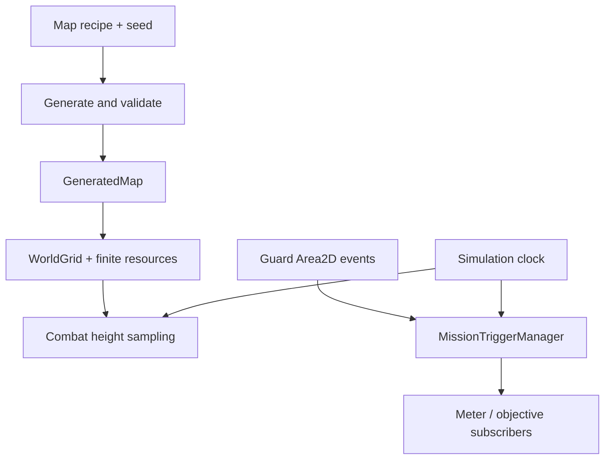

# Stage 3 — Procedural maps, high ground và mission triggers

Engine: **Godot 4.5.2 Standard**, typed GDScript. Stage 3 thêm map chơi được vào
sandbox và mở rộng backend combat/campaign. Không cần plugin hoặc .NET.

## 1. Chạy và chỉnh thông số

- Mở `project.godot`, F5 → **Sandbox kinh tế Stage 1–5** → nhập seed ở HUD →
  **Forest / F8** (hoặc Enter). Menu F5 hiện có thêm 13 tactical mission demos;
  xem [CAMPAIGN_DEMOS.md](CAMPAIGN_DEMOS.md) về phạm vi tích hợp mới.
- F6/F7 giữ nguyên fixture 16/200 dân của Stage 1. Mọi reset thay thế toàn bộ map.
- Seed sai giữ nguyên world đang chơi. Seed giống nhau + cùng recipe, phiên bản
  generator và engine tạo cùng map. Bản này chưa có save/load hoặc network format.
- Chọn cây → click phải để khai thác. Mỗi cây là node Wood hữu hạn; chặt hết mở ô
  đi lại. Mỏ Gold/Stone dùng chính resource loop và bank/HUD của Stage 1.
- Đất sáng hơn biểu thị terrace cao hơn. Footprint công trình phải cùng cao độ.

Backend demo chạy cả map, một đòn trên đồi và ba lần bị phát hiện:

```sh
godot --headless --path . --script examples/stage3_backend_demo.gd -- --seed=1524
python3 tools/verify.py --godot /path/to/godot
```

Thay `godot` bằng đường dẫn executable trên máy. Demo kết thúc bằng
`STAGE 3 DEMO: PASS`; exit code khác 0 khi lỗi.

| Resource cấu hình | Giá trị mặc định / ý nghĩa |
|---|---|
| `data/maps/black_forest_default.tres` | Recipe map, mở và sửa trong Inspector |
| `seed_value`, `map_size` | 1524, 64×40; kích thước cho phép 48×32..192×192 |
| `initial_forest`, `smoothing_steps` | 0.63, 3 vòng cellular automata; đây là xác suất ban đầu, không phải tỷ lệ rừng cuối |
| `corridor_width` | 3 ô; có thể chọn 1, 3 hoặc 5 |
| `spawn_clear_radius` | 5; khoảng trống vuông quanh mỗi spawn, san về cao độ 0 |
| `gold_veins`, `stone_veins` | 6/4 cụm; mặc định mỗi cụm dài 2..4 ô |
| `max_attempts`, `max_elevation` | Tối đa 4 lượt sinh, cao độ 0..2 |
| `wood_per_tree`, `gold_per_tile`, `stone_per_tile` | 100W / 800G / 350S, hữu hạn ở từng ô |
| `data/missions/secret_oath_default.tres` | Thông số Joß Fritz / Secret Oath prototype |
| `protagonist_id`, `protagonist_team` | `joss_fritz`, team 0 |
| `exposure_seconds` | 2 giây nhìn thấy liên tục từ meter 0 để đầy 100 |
| `decay_per_second` | Giảm 50 điểm/giây khi không guard nào thấy |
| `rearm_unseen_seconds` | Tối thiểu 2 giây thoát toàn bộ LOS, đồng thời meter phải về 0 |
| `detection_limit` | 3 lần đầy thanh → failure, chỉnh được 1..10 |

Model chụp bản sao config khi tạo; sửa Inspector/resource sau đó chỉ ảnh hưởng
lần tạo mới. Tất cả timer là **game seconds**, không đọc đồng hồ thực.

## 2. Kiến trúc và đường đi dữ liệu

| Lớp / file | Trách nhiệm |
|---|---|
| `BlackForestConfig` | Kiểm tra giới hạn tham số trước khi cấp phát |
| `BlackForestGenerator` | RNG riêng, CA, carve đường, ore placement, kiểm tra connectivity |
| `GeneratedMap` | Tiles, elevations, hai spawns, corridor/choke/vein metadata, signature và errors |
| `BlackForestFactory` | Chuyển dữ liệu sang `RtsSimulation` / resource nodes / starter economy |
| `WorldGrid` | Blockers tĩnh và cao độ riêng; giữ quy ước navigation bốn hướng |
| `HighGroundDamage` | Hàm thuần nhân sát thương và làm tròn HP |
| `CombatWorld.bind_terrain()` | Adapter lấy cao độ tại tâm vật lý của attacker/target |
| `MissionTriggerManager` | Trạng thái chiến dịch, hợp các guard đang thấy, meter và result events |
| `GuardLosArea` | Adapter `Area2D` nhận body enter/exit; không quét scene mỗi frame |
| `RtsSimulation.step()` | Một driver chung cho economy, combat và mission được bật |



Simulation vẫn độc lập với Node/UI. Chỉ adapter LOS và presentation phụ thuộc
SceneTree. Combat, mission và villager ID là các registry riêng; host giữ mapping,
không suy luận rằng ID giống số thì là cùng thực thể.

## 3. Thuật toán Black Forest

1. Validate recipe; sai trả `GeneratedMap.errors`, không tạo map khổng lồ hoặc
   lặp vô hạn. Dùng các `RandomNumberGenerator` cục bộ cho rừng, đường, mỏ và height.
2. Điền rừng ngẫu nhiên rồi chạy CA tám láng giềng: ít nhất 5 ô rừng → rừng.
   Biên ngoài và dải dọc giữa rộng 5 ô được giữ rừng.
3. Mở hai spawn clearings và ba hành lang nối trái/phải, khoảng 1/4, 1/2, 3/4
   chiều cao. Hành lang có độ rộng recipe, bảo vệ cả footprint khỏi placement mỏ.
   Dải rừng giữa bảo đảm đây là ba điểm hẹp thật ở trạng thái map ban đầu.
4. Flood fill bốn hướng từ spawn trái; chuyển các túi đất cô lập thành rừng.
5. Xáo candidate bằng RNG cục bộ. Thử từng vein 2..4 ô; không chồng spawn/đường,
   không tiếp giáp vein khác. Sau mỗi placement, kiểm tra mọi ô đất còn nối được
   và **từng ô ore có cạnh tiếp xúc đất reachable**. Sai thì rollback placement.
6. Nội suy lattice ngẫu nhiên rồi lượng tử hóa thành terraces; san clearings về 0.
7. Kiểm tra đủ số vein và connectivity. Nếu thất bại, thử stream của attempt kế
   tiếp, tối đa `max_attempts`. Hết lượt trả lỗi, UI giữ world cũ.

Chi phí CA khoảng O(width×height×smoothing_steps); mỗi candidate vein có thể cần
một flood fill O(width×height). Tổng candidate, kích thước và attempts đều bị chặn.
Generation chạy khi tạo/reset, không chạy ở simulation tick. Recipe quá dày rừng
hoặc đòi quá nhiều vein có thể thất bại có kiểm soát. Không cam kết mọi recipe hợp
lệ về kiểu dữ liệu đều chứa đủ đất cho tài nguyên yêu cầu.

`GeneratedMap` là dữ liệu tin cậy do generator trả; coi như bất biến sau factory.
Không dùng nó làm parser cho save/mod không tin cậy. `signature()` là fingerprint
kiểm thử theo phiên bản, chưa phải định dạng lockstep xuyên phiên bản engine.

Factory thêm một Town Center, 16 dân, housing 16, 3 node Food×150 và kho
500F/800W/500G/500S. Đó là **scenario grants** để thử loop; không phải opening cân
bằng của GDD. Rừng bên trong có thể chưa khai thác ngay được; chặt từ bìa mở dần.
Ore được bảo đảm tiếp cận từ đầu. Logging có thể mở đường mới và phá choke ban đầu.

## 4. Damage +25% từ high ground

Trong top-down 2D, `position.x/y` là vị trí trên mặt phẳng; **không dùng
`position.y` làm độ cao**. `WorldGrid.elevations` lưu vertical height. Nếu host
sau này là 3D, dùng `CombatWorld.set_elevation(id, body.global_position.y)` khi
world chưa bind terrain.

```text
normal = max(1, attack - matching_melee_or_pierce_armor)
counter = sum(max(0, matching_class_bonus - matching_class_armor))
subtotal = normal + counter
factor = 1.25 if attacker_height > defender_height else 1.0
total = floor(subtotal * factor + 0.5)
```

Không có attack/attack period thì tổng vẫn 0. Nhân **một lần sau armor/counter**;
không nhân thêm theo số bậc cao độ, không thêm phạt khi thấp hơn. HP là số nguyên,
làm tròn half-up cuối phép tính: Pike → Ritter 27 thành **34**; 26 thành 33;
1 thành 1 do lượng tử hóa HP. Chưa áp dụng cover hoặc ranged miss.

`DamageCalculator.calculate()` giữ `normal`, `bonus`, `by_class`, `total` và bổ
sung `subtotal`, `height_multiplier`, `height_bonus` cho tooltip/combat log.

`RtsSimulation.enable_combat()` tự bind grid. Spawn/set_position phải trong
bounds; height lấy từ `floor(actual_center)` tại spawn, movement update và ngay
trước mỗi đòn. Cả target và attacker đều được lấy lại để terrain edit không để
height cũ. Host phải đưa tâm vật lý hiện tại qua `set_position`, không dùng ô
đích được reserve của Stage 1. Range vẫn đo trên mặt phẳng, không phải khoảng
cách 3D. Height là terrace đi được; cliff cần blocker riêng. Foundation preview
và xác nhận đều yêu cầu toàn bộ footprint cùng height.

World standalone chưa bind terrain vẫn nhận tọa độ bất kỳ hữu hạn và explicit
height, kể cả âm. Khi bind grid, grid là nguồn height duy nhất; manual setter bị
từ chối. Không được sửa trực tiếp `unit.position` để vượt validation của host API.

## 5. Quy tắc detection và mission lifecycle

Detection được định nghĩa là **một episode nhìn thấy đủ lâu**, không phải mỗi
physics callback. Meter và counts hiển thị bằng cách subscribe `changed`:

| Tình huống | Hành vi |
|---|---|
| Enemy guard đúng ID thấy đúng hero | Thêm guard vào tập visible |
| Hai guard cùng thấy / callback trùng | Một tốc độ tăng meter, không nhân theo guard |
| Chỉ một guard mất sight trong khi guard khác còn thấy | Tiếp tục exposure |
| Meter đầy | Counts +1; khóa việc tính thêm trong episode hiện tại |
| Liên tục ở trong LOS sau khi đầy | Không tăng counts thêm |
| Thoát tất cả LOS | Meter giảm và unseen timer chạy |
| Vào lại trước khi đủ điều kiện rearm | Không có detection mới; unseen timer trở về 0 |
| Meter 0 và đủ unseen delay | Armed lại, episode tiếp theo có thể tăng counts |
| Counts đạt limit | State FAILED, `mission_failed` emit đúng một lần |
| `complete()` trước failure | State COMPLETED, không thể thất bại sau đó |
| Pause | Không tiến meter, timer hoặc counts |
| Guard disable/despawn | Gỡ contribution ngay, không phụ thuộc exit callback |

Một phần exposure chưa đạt 100 có thể tích tiếp nếu vào lại trước khi meter giảm
hết. Sau một detection đã xác nhận, latch chỉ mở sau khi đủ cả hai điều kiện
rearm. Muốn reset mission, tạo model mới; gọi enable lần hai không xóa tiến độ.
`complete()` do objective host quyết định; model không tự cho thắng khi trốn thoát.

`mission_failed`, `detection_confirmed`, `mission_completed` và `changed` đưa
snapshot gồm `state`, `meter`, `detections`, `limit`, `armed`, `visible_guards`,
`elapsed`, `protagonist_id`. MissionResult đã commit trước khi emit; subscriber
không thể hủy lần phát hiện thứ ba bằng callback. Queue mutation sau `advance()`;
API từ callback đang emit trả false. Chỉ có một driver gọi `advance`, không gọi
thêm nếu mission đã được gắn vào `RtsSimulation.step()`.

```gdscript
var config := load("res://data/missions/secret_oath_default.tres") as StealthMissionConfig
var mission := simulation.enable_stealth(config)
mission.changed.connect(update_detection_hud)
mission.mission_failed.connect(on_mission_failed) # Host mở màn hình thất bại.
# Ngoài Area2D, host có thể feed LOS từ một vision service khác:
mission.register_guard(&"north_gate", 1)
mission.report_los(&"north_gate", &"joss_fritz", true)
simulation.step() # Advances once; repeated every fixed game step.
```

## 6. Gắn LOS collider vào một scene

1. Hero Joß Fritz là `CharacterBody2D`/`PhysicsBody2D` có collider, đặt vào một
   collision layer riêng, ví dụ layer 1.
2. Mỗi guard thêm `GuardLosArea` với `CollisionShape2D` hoặc
   `CollisionPolygon2D` mô tả volume nhìn. Chọn mask chứa layer của hero;
   đặt collision_layer = 0 nếu LOS không cần bị body khác phát hiện.
3. Gọi `guard_area.configure(mission, unique_guard_id, enemy_team, hero_body)`.
   Có thể gọi trước add_child. ID phải duy nhất; khi configure trong tree, false
   báo đăng ký thất bại. Đặt transform/cone theo hướng guard trong scene host.
4. Adapter nhận `body_entered/body_exited` và filter **đúng instance hero**.
   Nhiều shape của cùng body không làm tăng counts. Dùng `set_guard_active(false)`
   khi guard chết/disable; node ra tree sẽ unregister. Hero bị free cũng bỏ sight.
5. Clock nằm ở simulation host; adapter không có `_process`, polling hoặc Timer
   riêng. Movement/physics của scene host cũng cần tuân theo pause của game.

**Phạm vi LOS:** đây là giao nhau với volume do level designer đặt, đúng Stage 3.
Chưa có raycast che khuất bởi tường/cây, fog of war, detection theo hướng tự động
hoặc patrol AI. Một `CircleShape2D` nghĩa là thấy mọi hướng trong hình tròn. Muốn
cone thì author polygon; muốn occlusion thì vision service phải lọc trước khi
feed cùng API. Đừng đặt volume xuyên tường rồi gọi đó là vision có occlusion.
Collider transform có hiệu lực tại physics frame; đọc overlap ngay sau teleport
không phải kết quả mới. Tests chờ physics frames và kiểm tra enter/exit thật.

## 7. Khác biệt có chủ ý với GDD Phase 3

Prompt Stage 3 hiện tại có quyền ưu tiên trên GDD cũ, nhưng không sửa lịch sử đã
lưu trong `docs/gdd`:

- GDD cũ không cho bonus damage theo cao độ; Stage 3 yêu cầu **+25%**.
- GDD A1 cũ là Allstedt/Thomas Müntzer và hệ Alert/chase. Stage 3 yêu cầu **Joß
  Fritz, detection 3 lần**. Prototype đặt tên Secret Oath và không gán Joß Fritz
  cho Allstedt/Frankenhausen hoặc tự thêm ngày/sự kiện lịch sử.
- Map hiện tại là compact sandbox 64×40, choke 1/3/5 ô. Chưa triển khai đầy đủ
  RMS ranked 160×160, đối xứng chiến lược 180°, corridors 12/8 ô, tỷ lệ rừng
  45–55%, ngân sách tài nguyên và fairness constraints trong GDD.
- Trên map lớn, tỷ lệ rừng cuối có thể cao hơn nhiều vì dọn túi đất cô lập;
  `initial_forest` không bảo đảm một final forest quota.
- F8 chỉ tạo sandbox kinh tế/navigation. Stage 3 ban đầu cung cấp backend;
  scene `campaign.tscn` hiện tích hợp hero điều khiển, patrol volumes và HUD mục
  tiêu thành các demo nhỏ. Chưa có campaign toàn cỡ/cutscene; giới hạn và các
  mốc thời gian rút gọn được ghi riêng trong `CAMPAIGN_DEMOS.md`.

Tham khảo API engine chính thức:
[Area2D](https://docs.godotengine.org/en/4.5/classes/class_area2d.html),
[RandomNumberGenerator](https://docs.godotengine.org/en/4.5/classes/class_randomnumbergenerator.html),
[Resource](https://docs.godotengine.org/en/4.5/classes/class_resource.html).
